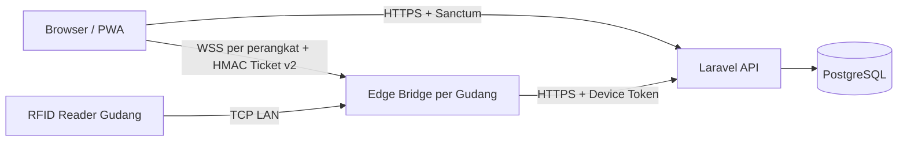

# MOSA WMS RFID — Arsitektur Sistem

> Snapshot implementasi: 1 Oktober 2026. Source of truth: routes/controllers/services, migrations, `edge-bridge/src`, dan konfigurasi deployment. Status: **IMPLEMENTED**, **PARTIAL**, **PLANNED**, **KNOWN ISSUE**.

## Komponen

| Komponen | Status | Tanggung jawab |
|---|---|---|
| React 18 + Vite PWA | IMPLEMENTED | Dashboard, alur handheld, monitoring, Web Bluetooth pada browser yang didukung. |
| Laravel 13 / PHP 8.3 | IMPLEMENTED | REST API, Sanctum, state bisnis, approval, custody, reporting. |
| PostgreSQL 16 | IMPLEMENTED | Data transaksi dan audit. Proteksi append-only DB masih PARTIAL. |
| Node.js Edge Bridge | PARTIAL | Parser reader, direction engine, batching, WebSocket lokal, offline queue, telemetry. Ada known issue timer runtime. |
| Reader HW-VX/RC4 | PARTIAL | Parser tersedia; kompatibilitas dan RF wajib commissioning per model/firmware. |
| Relay fisik | PLANNED | Saat ini hanya simulasi logis pulse 5 detik. |
| CCTV nyata | PLANNED | Saat ini hanya marker file simulasi, bukan frame RTSP/ONVIF. |

## Topologi



Edge normalnya berjalan pada PC/mini-PC di jaringan gudang. Menjalankan Edge di VPS hanya valid bila tersedia VPN/routing privat ke reader. Port TCP reader dan WebSocket Edge tidak boleh dibuka langsung ke Internet.

## Trust Boundary

- Pengguna memakai token Sanctum personal.
- Edge memakai token unik perangkat aktif; backend menyimpan hash SHA-256.
- Backend menentukan identitas device, gudang, dan gate dari token—bukan payload.
- Kontrol WebSocket memakai tiket HMAC singkat yang terikat user, gudang, command, TTL, dan replay ID.
- `gate_transaction_id` wajib eksplisit. Backend tidak menebak sesi aktif.
- Direct HTTP dari reader hanya dapat didukung melalui adapter tersertifikasi yang memenuhi seluruh kontrak device, idempotensi, sequence, dan autentikasi.

## Alur Material

### Dispatch dan Receiving

```mermaid
sequenceDiagram
    actor P as Procurement
    participant API as Laravel API
    actor S as Storeroom
    P->>API: POST /deliveries/dispatch-scan + manifest EPC
    API-->>P: pending / in_transit
    S->>API: POST /deliveries/{id}/receiving-scan
    alt Full EPC match
        API-->>S: approved / matched + STOCK_IN
    else Mismatch
        API-->>S: mismatch_flagged; tanpa STOCK_IN
    end
```

Preview receiving merupakan langkah UI. API receiving melakukan commit saat dipanggil. Penyelesaian mismatch manual tanpa EPC dinonaktifkan (`410`).

### Work Order dan Gate Out

1. WO approved menetapkan BOQ.
2. Storeroom hanya mengganti `prepared_qty`.
3. PIC membuat `POST /gate/transactions`.
4. OUT dapat auto-approved berdasarkan aturan kuota/preparation; sesi memakai rolling idle 15 menit.
    Satu warehouse dikunci untuk satu sesi `pending_approval`/`approved`; sesi baru menunggu sesi lama selesai atau dibatalkan.
5. Edge mengirim `/gate/event` dengan event UUID, observed time, sequence, EPC, dan transaction ID.
6. Full set EPC valid memposting `GATE_OUT`, mengubah lokasi tag, BOQ withdrawal, dan status transaksi.
7. Finalisasi parsial dinonaktifkan.

### Return

1. PIC membuat `/returns/request`; sesi `IN_RETURN` auto-approved selama 4 jam.
2. Event gerbang valid menyelesaikan fase gate-in. Setelah aktivitas valid, engine saat ini memakai reset idle 15 menit.
3. Storeroom berbeda dari PIC memverifikasi jumlah dan EPC.
4. Full match memposting `STOCK_IN`/returned quantity; mismatch tidak memutasi stok.

## Keputusan Gerbang

### Dual antenna

- `A_TO_B` berarti `OUT`.
- `B_TO_A` berarti `IN`.
- Pembacaan satu sisi belum menjadi perlintasan lengkap.
- Backend menurunkan arah dari sequence; `direction` kiriman Edge bukan otoritas.

### Single antenna

- Arah berasal dari tipe sesi server: `OUT_FULFILLMENT` atau `IN_RETURN`.
- RSSI bukan penentu arah.

### Fail-closed

Gate tetap terkunci bila sesi tidak ada/expired/terminal, device/gudang tidak cocok, arah salah, EPC asing/status salah/lintas proyek, atau jumlah melebihi izin. Undercount menghasilkan `STANDBY`; hanya set lengkap valid menghasilkan keputusan unlock logis.

## Idempotensi dan Offline

- Event diidentifikasi pasangan `(gate_device_id,event_id)`.
- Replay mengembalikan keputusan tersimpan tetapi selalu `unlock_gate=false`.
- Queue lokal memakai FIFO, single-flight, file atomik, retry, dan dead-letter.
- Otorisasi tidak dijamin tersedia offline; Edge mengambil transaksi aktif dari backend.
- **KNOWN ISSUE:** `_takeBatch()` saat ini menghentikan timer flush, heartbeat, dan watchdog setelah batch pertama. Reliability belum boleh dinyatakan lulus sampai source diperbaiki dan regression test tersedia.

## Telemetri dan Real-Time

- Heartbeat default 10 detik; configurable.
- Status Edge dan reader dipisahkan. Edge offline membuat status reader `unknown`.
- WebSocket Edge menyediakan aliran lokal dan control commands setelah autentikasi tiket.
- `/gate/live-feed` menyediakan polling HTTP dengan cursor `since_id` dan payload ringkas.
- `/gate/stream` menyediakan SSE dengan cursor resume, heartbeat 1,5 detik, dan koneksi sekitar 10 detik. Endpoint ini menahan worker selama koneksi; bukan jalur berskala besar.
- Gate Monitor memakai WebSocket Edge saat dapat dijangkau, SSE VPS sebagai fallback, lalu polling HTTP jika SSE gagal. Pembacaan tag live dibatch per frame UI; keputusan server tetap direkonsiliasi dengan event audit tersimpan.

## Custody dan Data

Custody Service memvalidasi EPC, item, referensi, dan menjalankan mutasi dalam transaksi. Model ledger menolak update/delete. Namun DB belum memiliki trigger/privilege append-only, `item_id` masih CASCADE, dan SQL langsung tetap dapat mengubah histori. Detail: [`schema.md`](schema.md).

Event custody aktif: `STOCK_IN`, `PREPARED`, `GATE_OUT`, `GATE_IN`, `FIELD_RETURN`, `INSTALLED`, serta event administrasi tag termasuk `TAG_ENROLLED`. Enrollment hanya mencatat identitas dan user personal; gudang adalah konteks reader/audit, bukan stok (`last_warehouse_id=null`). `PREPARED` dan `INSTALLED` dapat bersifat quantity-level; tidak semua record memiliki EPC/GPS/foto.

## Deployment

Central stack: Nginx production image, frontend static build, PHP-FPM, dan PostgreSQL internal. Edge ditempatkan per gudang. Production wajib HTTPS/WSS, secret acak, private reader network, backup/restore test, dan firewall minimum. Gunakan `docker-compose.production.yml`; Compose production tidak mempublikasikan PostgreSQL atau port Edge ke host secara default.

## Gap Produksi

1. Perbaiki timer Edge setelah batch pertama.
2. Tambahkan proteksi DB append-only dan revisi FK destruktif.
3. Terapkan role/permission guard pada endpoint mutasi yang masih auth-only.
4. Implementasikan persistence eskalasi stock-opname/return mismatch.
5. Integrasikan dan commissioning relay/CCTV bila diperlukan.
6. Benchmark latensi/throughput sebelum menetapkan SLA.

Kontrak detail: [`api-spec.md`](api-spec.md), [`schema.md`](schema.md), [`rules.md`](rules.md), dan [`../RENCANA_HARDENING_FASE_2.md`](../RENCANA_HARDENING_FASE_2.md).
