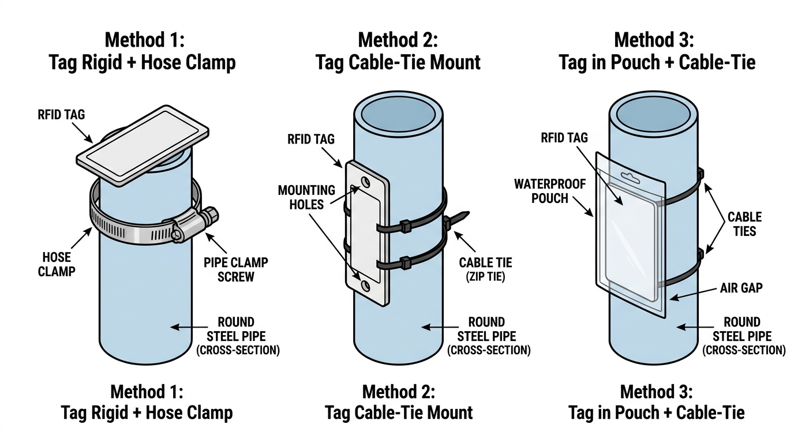

# Panduan Metode Pemasangan Tag RFID pada Tiang Besi Bulat

Dokumen ini memuat panduan teknis dan contoh ilustrasi pemasangan tag UHF RFID pada material logam melengkung/lingkaran (seperti pipa besi, tiang tiang konstruksi, atau tiang FO).

---

## 📷 Ilustrasi Metode Pemasangan

---

## Ringkasan Perbandingan Metode

| Metode | Deskripsi | Jarak Baca Estimasi (Antena 12 dBi) | Kemudahan & Fleksibilitas Bentuk Lingkaran | Estimasi Biaya Tambahan |
|:---|:---|:---:|:---:|:---:|
| **Method 1: Tag Rigid + Hose Clamp** | Tag on-metal ber-casing rigid diikat dengan klem selang / klem pipa stainless (*hose clamp*) | **5 – 10 meter** | ⭐⭐⭐⭐⭐ Klem fleksibel melingkari diameter tiang apapun | Rp 5.000 – Rp 15.000 (klem stainless) |
| **Method 2: Tag Cable-Tie Mount** | Tag on-metal ABS yang memiliki 2 lubang samping diikat melingkar menggunakan kabel ties outdoor tahan UV | **4 – 8 meter** | ⭐⭐⭐⭐⭐ Mengikuti kelengkungan pipa | Rp 1.000 – Rp 2.000 (kabel ties UV-resistant) |
| **Method 3: Tag in Pouch + Cable-Tie** | Tag RFID UHF standar dimasukkan ke dalam plastik *waterproof pouch* gantung lalu diikat melingkari pipa | **6 – 12 meter** | ⭐⭐⭐⭐⭐ Kantung menggantung memberi *air gap* (isolator udara dari logam) | Rp 2.000 – Rp 5.000 (pouch + kabel ties) |

---

## Penjelasan Detail Per Metode

### 1. Method 1: Tag Rigid + Hose Clamp (Klem Selang / Pipa Stainless)
* **Konsep:** Menggunakan tag on-metal dengan spacer internal tebal (bisa berupa tag anti-metal ABS atau PCB tag). Tag diletakkan di atas penampang pipa atau pada sisi samping, lalu dikencangkan dengan obeng pada sekrup klem pipa (*pipe clamp screw*).
* **Kelebihan:**
  * Sangat kuat terhadap benturan fisik, gesekan saat pengangkutan tiang di bak truk, dan cuaca ekstrem.
  * Tahan bertahun-tahun di lingkungan outdoor industri / konstruksi.
  * Tidak mudah lepas atau getas terkena panas matahari.
* **Catatan Lapangan:** Gunakan klem berbahan stainless steel (SUS304) agar tidak berkarat.

---

### 2. Method 2: Tag Cable-Tie Mount (Tag ABS dengan Lubang Pengikat)
* **Konsep:** Menggunakan tag on-metal industri (seperti EL-UHF-MT05 / WZ-Y258 / tag balok ABS) yang memiliki lubang (*mounting holes*) di kedua sisinya. Tag dipasang menempel pada kontur lengkung tiang, lalu diikat erat menggunakan 2 baris kabel ties (*zip ties*).
* **Kelebihan:**
  * Pemasangan sangat cepat di lapangan (tanpa perlu obeng atau alat khusus, cukup tang potong).
  * Biaya material sangat ekonomis.
  * Tetap memberikan performa jarak baca 4–8 meter berkat material ferrite shielding bawaan tag.
* **Catatan Lapangan:** Wajib menggunakan kabel ties khusus outdoor hitam bertanda *UV Resistant* (Nylon 66) atau kabel ties stainless steel agar tidak putus akibat paparan panas matahari berkepanjangan.

---

### 3. Method 3: Tag in Pouch + Cable-Tie (Kantung Kedap Air Berongga Udara)
* **Konsep:** Memanfaatkan prinsip fisika gelombang radio: gelombang UHF teredam bila antena menempel langsung pada logam, namun logam dapat berfungsi sebagai pemantul (*reflector*) jika ada celah/jarak (*air gap* minimal 5–10 mm) antara tag dan tiang besi. Tag standar dimasukkan ke pouch waterproof transparan berlubang, lalu diikat dengan tali/kabel ties sehingga tag memiliki sedikit rongga udara terhadap tiang.
* **Kelebihan:**
  * Dapat menggunakan label tag UHF biasa (harga jauh lebih murah dibanding tag anti-metal khusus).
  * Jarak baca bisa sangat jauh (6–12 meter) karena tag tidak terdegradasi efek induksi langsung logam.
* **Catatan Lapangan:** Pastikan pouch tertutup rapat (*seal waterproof*) agar tidak kemasukan air hujan yang dapat mengurangi efisiensi RF.

---

## ⚠️ Mengapa Tag Stiker Fleksibel Tipis (seperti EL-UHF-TML7009S) Jaraknya Pendek?

Tag stiker tipis anti-metal fleksibel (dimensi ~30×15 mm, tebal 1.2 mm) memiliki lapisan ferit isolator yang sangat tipis dan luas penampang antena sangat kecil.
* Spesifikasi pabrikan hanya mencapai **40 – 50 cm** (meski reader disetel maksimal 30 dBm).
* Jika ditekuk mengikuti lengkungan pipa besi berdiameter kecil, jalur antena mikro di dalam stiker berisiko mengalami pergeseran frekuensi tuning (*frequency detuning*).
* Oleh karena itu, untuk tiang besi proyek yang membutuhkan pemindaian jarak jauh (gate detection bak truk 5–15 meter), **disarankan menggunakan salah satu dari 3 metode di atas**.
