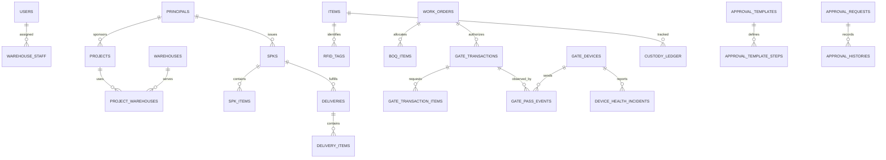

# MOSA WMS RFID — Skema Database

> Snapshot migration: 1 Oktober 2026. Source of truth: [`backend/database/migrations`](../backend/database/migrations). Dokumen ini merangkum skema efektif; aturan bisnis yang hanya dijaga controller/service tidak dianggap constraint DB. Database: **PostgreSQL 15**.

## Ringkasan

- 30 tabel domain, 10 tabel framework/infrastruktur.
- Database: PostgreSQL 15. Status/domain value umumnya `VARCHAR`; tidak ada DB `CHECK` untuk sebagian besar enum bisnis.
- Kolom kuantitas/nominal umumnya belum memiliki `CHECK >= 0`.
- Timestamp standar `created_at/updated_at`, kecuali `custody_ledger` hanya `created_at`.

## Tabel Tambahan — Dokumen Barang

| Tabel | Kolom penting | Keterangan |
|:------|:--------------|:-----------|
| `shipping_documents` | type (inbound/outbound), warehouse_id, status, notes, attachments (JSONB), created_by | Dokumen penerimaan/pengiriman barang. `attachments` menyimpan array path file lampiran. |
| `shipping_document_items` | document_id, item_id, expected_qty | Item material dalam dokumen. |
| `shipping_document_tags` | document_item_id, tag_epc, assigned_by, assigned_at | Tag RFID yang di-assign ke item dokumen. |

## ERD Domain Inti

## Identitas dan RBAC

| Tabel | Kolom/relasi penting | Constraint/index |
|---|---|---|
| `users` | name, email, password, string `role`, phone, is_active | PK id; email unique. `role` bukan FK ke `roles`. |
| `roles` | name, code, badge, color, description, is_system | code unique. |
| `role_permissions` | role_id, module_key, is_allowed | FK role CASCADE; unique `(role_id,module_key)`. |

## Organisasi, Proyek, Gudang

| Tabel | Kolom/relasi penting | Constraint/index |
|---|---|---|
| `principals` | name, code, contact fields, address | code unique. |
| `projects` | principal_id nullable, code, name, client/location/status | principal `NULL ON DELETE`; code unique. |
| `warehouses` | project_id nullable, pic_user_id nullable, code/name, phone `VARCHAR(30)`, capacity signed nullable tanpa default, gate_mode, address/GPS/is_active | project `NULL ON DELETE`; PIC `RESTRICT`; code unique. |
| `warehouse_staff` | warehouse_id, user_id, `role_in_warehouse` non-null default `staff` | warehouse CASCADE; user **CASCADE**; unique pair. |
| `project_warehouses` | project_id, warehouse_id, is_primary | kedua FK CASCADE; unique pair; belum menjamin satu primary per project. |

## Material dan RFID

| Tabel | Kolom/relasi penting | Constraint/index |
|---|---|---|
| `items` | code/name/category, is_metal, is_reusable, is_serialized_tag, unit, min_stock, description, epc_prefix, epc_suffix_digits, epc_next_sequence | code dan nullable epc_prefix unique. Counter di-lock saat generate batch; prefix lama tidak mengubah EPC existing. |
| `rfid_tags` | epc, item_id, tag_type/status, last_warehouse_id, project_id, last_read_at, notes | epc unique; status mencakup `reserved`; item CASCADE; warehouse/project `NULL ON DELETE`. Belum ada TID/password/lock. |

## Kontrak dan Delivery

| Tabel | Kolom/relasi penting | Constraint/index |
|---|---|---|
| `spks` | principal/project/creator, spk_number, title, total_amount, payment fields, document, dates, notes | number unique; principal CASCADE; project NULL; creator `RESTRICT`. |
| `spk_items` | spk_id, item_id, target_qty, unit_price, received_qty, notes | kedua FK CASCADE; belum unique `(spk_id,item_id)`. |
| `deliveries` | spk/warehouse, dispatcher/receiver, number, dispatch/received EPC JSON, status/reconciliation, bukti dispatch (`proof_photo_url`, `document_url`), bukti receiving immutable (`receiving_proof_photo_url`, `receiving_document_url`), times/notes | number unique; SPK/warehouse CASCADE; users `RESTRICT`. |
| `delivery_items` | delivery_id, item_id, spk_qty, delivered_qty, difference_qty, notes | kedua FK CASCADE; belum unique `(delivery_id,item_id)`. |

Nilai delivery dipakai aplikasi sebagai string, termasuk `pending`, `in_transit`, `matched`, `mismatch`, `mismatch_shortage`, `approved`, dan `mismatch_flagged`; DB tidak membatasi enum.

## Work Order dan BOQ

| Tabel | Kolom/relasi penting | Constraint/index |
|---|---|---|
| `work_orders` | project_id, spk_id nullable, warehouse_id, pm/approver, wo_number/title/status, approval/target/notes | number unique; project/gudang CASCADE; SPK NULL; user audit `RESTRICT`. |
| `boq_items` | work_order_id, item_id, quota/prepared/withdrawn/returned/installed qty, notes | kedua FK CASCADE; belum unique pair atau constraint kuantitas. |

Status aplikasi mencakup `draft`, `pending_approval`, `approved`, `in_progress`, `completed`, `cancelled`.

## Gerbang, Armada, Edge

| Tabel | Kolom/relasi penting | Constraint/index |
|---|---|---|
| `vehicles` | plate_number, vehicle_type, driver/transporter, max_pole_capacity, is_active, notes | plate unique. |
| `gate_transactions` | number, WO/gudang/PIC/vehicle, plate snapshot, type/status, approval, validity, rejection_reason, notes | number unique; WO/gudang CASCADE; vehicle NULL; users `RESTRICT`. |
| `gate_transaction_items` | transaction_id, item_id, requested_qty, passed_qty, returned_condition | kedua FK CASCADE; belum unique pair. |
| `gate_devices` | warehouse_id, device_code/name, `device_role VARCHAR(30)` default `gate_controller`, model/network/status/heartbeat/metrics/tolerance, `api_token_hash VARCHAR(64)`, `edge_ws_url VARCHAR(2048) NULL` | gudang CASCADE; code unique; token hash unique nullable; index warehouse/status. Endpoint WSS Edge terpisah dari IP/port TCP reader; migration forward `2026_09_12_000001` tidak mengubah data lama. |
| `gate_pass_events` | device/event identity, observed_at, transaction/gudang/gate, direction/sequence, EPC JSON/count, CCTV, flags/details, decision/raw payload | device `RESTRICT`; transaction NULL; gudang CASCADE; unique `(gate_device_id,event_id)`. Kedua nullable melemahkan idempotensi event legacy. |
| `device_health_incidents` | gate_device_id, event_id UUID, component, status, reason, observed_at, received_at | device CASCADE; event_id unique global; index device/observed time. |

Status transaksi gerbang berbentuk string. Aplikasi juga memakai `return_verified` dan `return_mismatch`; tidak ada DB `CHECK`.

## Chain of Custody

### `custody_ledger`

| Kolom | Tipe/logika | Keterangan |
|---|---|---|
| `id` | BIGINT PK | Identifier. |
| `tag_epc` | VARCHAR nullable, indexed | Tidak memiliki FK ke `rfid_tags.epc`. |
| `item_id` | FK, CASCADE | Risiko: penghapusan item menghapus histori. |
| `holder_user_id` | FK, RESTRICT | Identitas actor dipertahankan. |
| `action` | VARCHAR indexed | Contoh `TAG_ENROLLED` (EPC wajib, tanpa referensi, gudang hanya konteks reader/audit; tidak mengubah stok), `STOCK_IN`, `PREPARED`, `GATE_OUT`, `INSTALLED`. |
| `ref_type`, `ref_id` | Polymorphic nullable, indexed | Tidak memiliki FK. |
| `warehouse_id` | FK nullable, NULL ON DELETE | Lokasi terkait. |
| `latitude`, `longitude`, `photo_url`, `notes` | Nullable | Bukti/konteks event. |
| `created_at` | TIMESTAMP indexed | Tidak ada `updated_at`. |

Model Eloquent menolak update/delete, tetapi DB belum memiliki trigger/privilege khusus. FK item masih CASCADE dan query SQL langsung tetap dapat mengubah data. Karena itu append-only belum dijamin mutlak pada level DB.

## Approval Engine

| Tabel | Kolom/relasi penting | Constraint/index |
|---|---|---|
| `approval_templates` | code, module, amount range, metadata | code unique; belum ada `min<=max` CHECK. |
| `approval_template_steps` | template, step_order, approver, SLA | template CASCADE; approver `RESTRICT`; unique template/order. |
| `approval_configs` | project/warehouse scope, module, template/use_template/is_active | project/gudang CASCADE; template NULL; index scope/module; belum memastikan tepat satu scope. |
| `approval_config_steps` | config, order, approver, SLA | config CASCADE; approver `RESTRICT`; unique config/order. |
| `approval_requests` | request number, module/reference, project/warehouse, actors/status/snapshot | number unique; project/gudang NULL; users `RESTRICT`; reference bukan FK. |
| `approval_histories` | request, designated/action user, action/comments/time | request CASCADE; users `RESTRICT`; belum ada unique urutan aksi. |

## Tabel Framework

- Auth/session: `password_reset_tokens`, `sessions`, `personal_access_tokens`.
- Cache: `cache`, `cache_locks`.
- Queue: `jobs`, `job_batches`, `failed_jobs`.
- Internal: `migrations`.

## Kebijakan Delete Efektif

Referensi actor audit utama memakai `RESTRICT`: SPK creator, delivery dispatcher/receiver, WO PM/approver, gate PIC/approver, custody holder, serta actor approval. User dinonaktifkan melalui API, bukan dihapus.

Risiko historis yang masih aktif:

- `warehouse_staff.user_id` tetap CASCADE karena migration hardening merujuk nama tabel lama `warehouse_users`.
- Penghapusan principal/project/gudang/WO/item dapat memicu cascade pada data transaksi atau ledger tertentu.
- Device delete menghapus incident; warehouse delete menghapus device/event/transaksi terkait.

## Constraint yang Belum Ada

1. Unique pair pada `spk_items`, `delivery_items`, `boq_items`, `gate_transaction_items`.
2. DB `CHECK` status, role, arah, mode, kategori, kondisi, dan angka non-negatif.
3. FK ledger EPC ke registry tag.
4. Satu primary warehouse per project.
5. Scope approval config tepat satu dari project/warehouse.
6. Event identity non-null untuk seluruh gate event.
7. Proteksi DB append-only untuk custody ledger dan bukti gerbang.

Gap tersebut merupakan backlog hardening, bukan jaminan sistem. Lihat [`../RENCANA_HARDENING_FASE_2.md`](../RENCANA_HARDENING_FASE_2.md).
